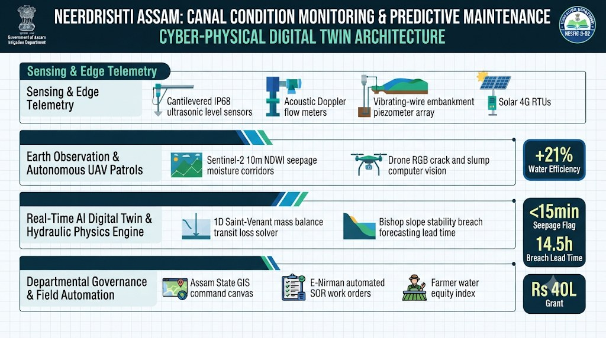
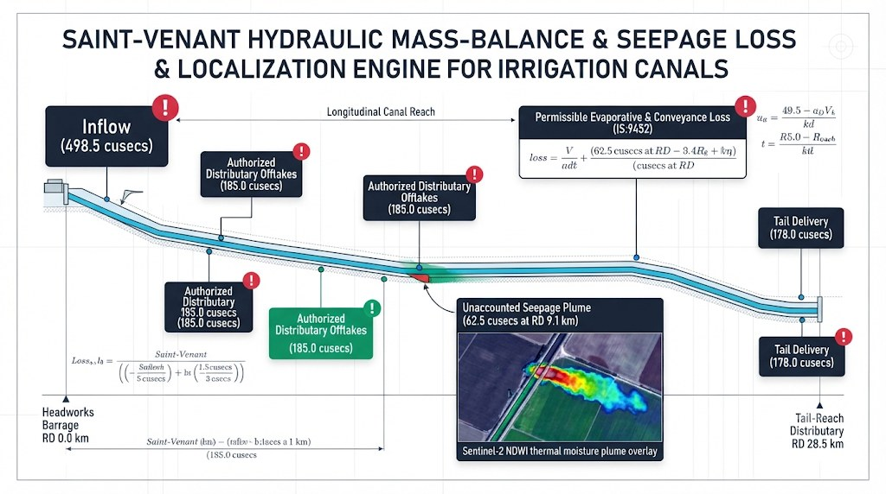
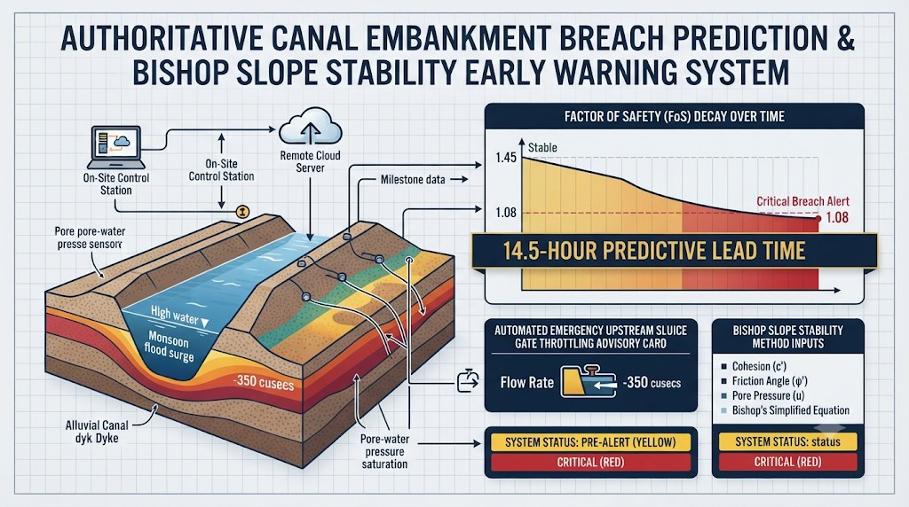
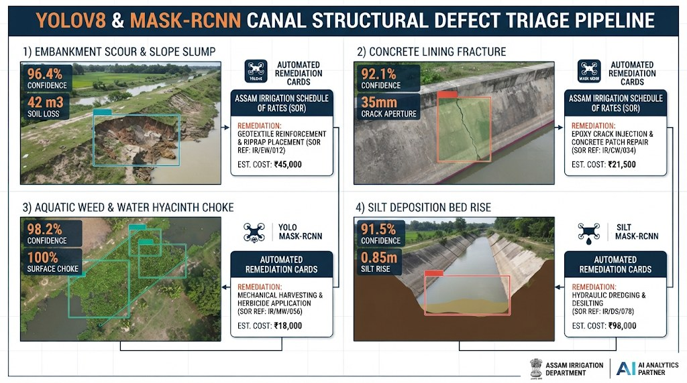
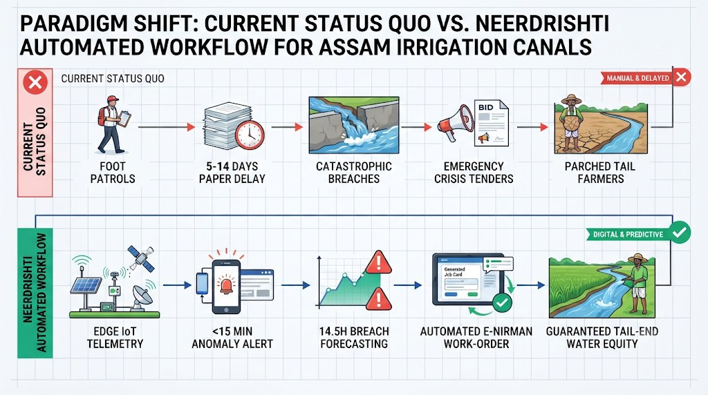
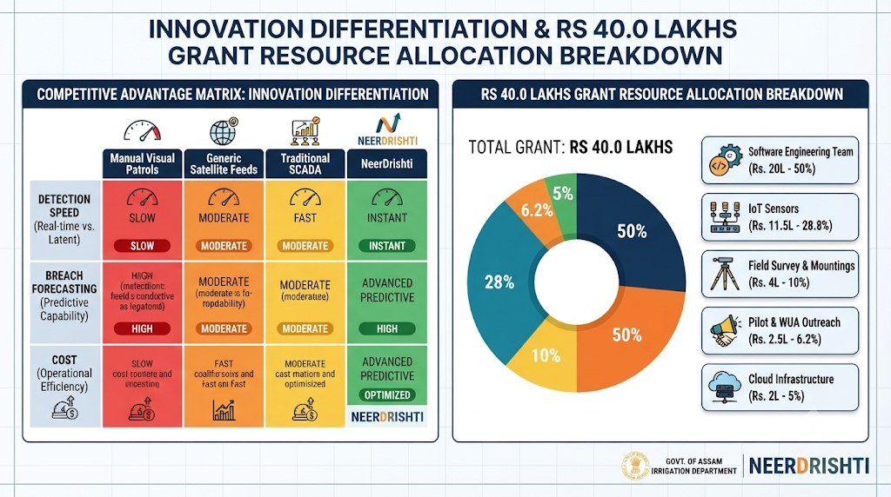
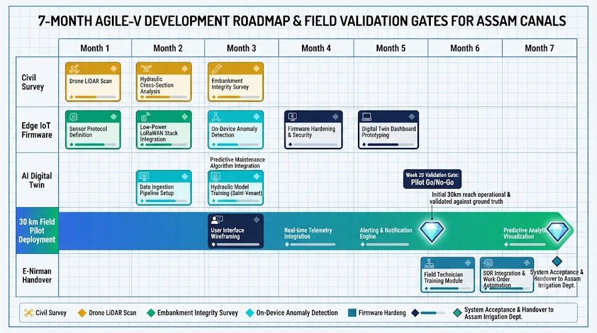
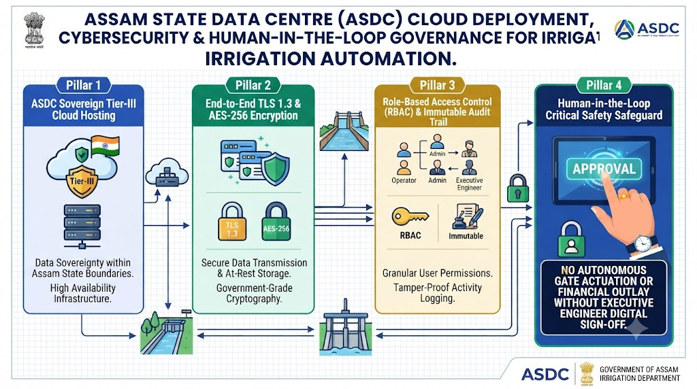

# NeerDrishti Assam (AquaCanal AI)
### AI-Powered Dynamic Hydraulic Loss Decomposition & Geotechnical Canal Health Monitoring System

[](https://opensource.org/licenses/MIT)
[](https://www.python.org/downloads/)
[](https://fastapi.tiangolo.com)
[](https://startup.assam.gov.in/nesfic26/problem-statements/nesfic-d-02)

**NeerDrishti Assam** is an end-to-end edge-to-cloud AI digital twin and geotechnical monitoring platform engineered for the **Irrigation Department, Government of Assam** under the **North East Seva First Innovation Challenge 2026 (NESFIC-D-02)**.

The platform transforms vulnerable, unlined, and silt-heavy earthen canals across Assam (e.g., Sukla, Jamuna, Dhansiri) by continuously estimating conveyance losses (seepage vs. unauthorized off-takes) and forecasting structural embankment breaches before catastrophic failures occur.

---

## 📌 Problem Statement Overview (NESFIC-D-02)
- **Problem Statement Code:** NESFIC-D-02 (Government Track — Irrigation Department, Govt. of Assam)
- **Challenge:** Real-time conveyance loss assessment (distinguishing natural soil seepage from unauthorized off-takes/theft) and early structural embankment breach forecasting in alluvial, high-precipitation monsoon terrains.
- **Grant Target:** ₹ 40.0 Lakhs Turnkey Pilot Deployment (30 km canal reach).

---

## 🏛️ System Architecture



NeerDrishti Assam operates across a robust 4-tier cyber-physical architecture:
1. **Perception & Edge Telemetry Tier:** Solar-powered FMCW 60 GHz radar stage gauges, acoustic transit-time Doppler velocity sensors, and MEMS inclinometer/piezometer arrays transmitting via 4G/LTE Cat-M1 and LoRaWAN fallback.
2. **Hydrodynamic Loss Decomposition Tier:** 1D Saint-Venant hydraulic mass-balance engine coupled with dynamic soil percolation models to isolate conveyance anomalies.
3. **Geotechnical Failure Forecasting Tier:** Bishop’s Simplified Method of Slices running dynamic pore-water pressure calculations to forecast slope Factor of Safety (FoS).
4. **Actionable Governance & Dispatch Tier:** Role-based GIS digital twin dashboard (Executive, SDO/Field Engineer, WUA Farmer) with automated E-Nirman API maintenance work-order dispatch.

---

## ⚡ Core Technical Features

### 1. Saint-Venant Hydrodynamic Mass Balance & Anomaly Decomposition
Disaggregates hydraulic losses every 15 minutes by subtracting natural Darcy-Richards soil percolation, surface evaporation, and authorized minor gate discharge from aggregate reach flow deficits $\Delta Q$:
$$\Delta Q_{\text{unaccounted}} = (Q_{\text{in}} - Q_{\text{out}}) - (Q_{\text{seepage}} + Q_{\text{evaporation}} + \sum Q_{\text{offtake}})$$
If $\Delta Q_{\text{unaccounted}} > 5\%$, the system flags unauthorized siphon/pumping off-takes with localization within $\pm 250$ meters.



### 2. Geotechnical Embankment Breach Forecasting
Computes real-time Factor of Safety (FoS) across earthen bunds using high-resolution DGPS RTK profiles and dynamic water infiltration models:
- **Normal Operating Status:** $\text{FoS} \ge 1.50$
- **Amber Advisory (Watch):** $1.20 \le \text{FoS} < 1.50$
- **Critical Red Alert (High Risk of Piping/Slumping):** $\text{FoS} < 1.20$

Triggers automated high-priority SMS/push notifications to SDOs and Executive Engineers 6 to 12 hours ahead of physical breach events.



### 3. Edge Computer Vision Defect Severity Matrix
YOLOv8 instance-segmentation network trained on alluvial earthen canals classifies longitudinal structural cracks, animal burrows/rat piping holes, toe erosion scouring, and aquatic weed choked reaches.



### 4. Operational Multi-Tier User Journey & E-Nirman Escalation
Empowers field patrollers with offline-first geofenced mobile auditing, sectional officers with dispatch triage, and executives with macro equity heatmaps.



---

## 📊 Grant Budget Allocation (₹ 40.0 Lakhs)

| Category | Allocation | Share | Details & Deliverables |
| :--- | :---: | :---: | :--- |
| **Software Development & Engineering Team** | **₹ 20,00,000** | 50.0% | 8 engineering specialists over 7 months: AI/ML, hydro-modelling, edge firmware, full-stack GIS, geotechnical safety, QA. |
| **IoT Sensors & Edge Hardware** | **₹ 11,50,000** | 28.8% | 20 telemetry solar nodes (FMCW radar, ultrasonic, 4G/LTE Cat-M1) + 2 calibrated acoustic flow meters for 30 km canal. |
| **Field Installation & RTK Topographic Survey** | **₹ 4,00,000** | 10.0% | DGPS RTK topographic survey, concrete sensor mounting poles, IP67 solar enclosures, and earthing protection. |
| **Pilot Validation, Calibration & WUA Outreach** | **₹ 2,50,000** | 6.2% | Ground acoustic Doppler cross-calibration, 5 Water Users Association workshops, multi-lingual field manuals. |
| **Cloud Infrastructure & ASDC Deployment** | **₹ 2,00,000** | 5.0% | Secure GPU compute (V100/A10G) for CV training, Assam State Data Centre (ASDC) staging, GIS hosting, data backups. |
| **Total Requested Grant** | **₹ 40,00,000** | **100.0%** | **Comprehensive end-to-end Turnkey Pilot (Sukla / Jamuna Canal System)** |



---

## 🗺️ 7-Month Implementation Roadmap



- **Phase 1 (M1–M2):** DGPS RTK Bathymetric Survey, Hydro-geological soil sampling, IoT hardware fabrication.
- **Phase 2 (M3–M4):** Canal sensor mounting, telemetry network provisioning, core hydrodynamic solver calibration.
- **Phase 3 (M5):** Mobile inspection app rollout, geofenced camera defect detection, E-Nirman integration.
- **Phase 4 (M6–M7):** Live monsoon pilot validation across 30 km canal reach, WUA farmer workshops, handover to Irrigation Dept.

---

## 🔒 Security, Compliance & Governance
- **Sovereignty:** Deployed on Assam State Data Centre (ASDC) MeghRaj Cloud infrastructure.
- **Compliance:** CERT-In certified guidelines, Aadhaar/e-KYC tokenization, Open-API MEITY interoperability.
- **Reliability:** Dual-failover telemetry (4G Cat-M1 with offline SD-card burst buffering and LoRaWAN fallback).



---

## 🚀 Quickstart & Local Dev Server

### Prerequisites
- Python 3.10+
- `pip install fastapi uvicorn reportlab matplotlib pypdf numpy`

### Running the Digital Twin Server
```bash
# Clone the repository
git clone https://github.com/RonHatibaruah/neerdrishti-assam.git
cd neerdrishti-assam

# Run dev server
python3 -m uvicorn backend.main:app --host 0.0.0.0 --port 8080
```
Open [http://localhost:8080](http://localhost:8080) in your browser to access the live GIS Digital Twin and Hydro-Simulation Console.

---

## 📄 Submission Documents
- [NESFIC_D02_Proposal_NeerDrishti.pdf](NESFIC_D02_Proposal_NeerDrishti.pdf) — Complete 12-section technical proposal (0.97 MB)
- [NESFIC_D02_Proof_of_Work_NeerDrishti.pdf](NESFIC_D02_Proof_of_Work_NeerDrishti.pdf) — Architectural schematics, equations, CV defect matrix, and BoM (1.10 MB)
- [NESFIC_D02_Full_Proposal_and_Proof_of_Work.pdf](NESFIC_D02_Full_Proposal_and_Proof_of_Work.pdf) — Unified master submission PDF (2.06 MB)
- [proposal/proposal_form_contents_ready_to_paste.txt](proposal/proposal_form_contents_ready_to_paste.txt) — Direct portal copy-paste text

---

## 👥 Contributors & Contact
Developed for the **NESFIC 2026 Innovation Challenge** in collaboration with regional hydraulic and geotechnical experts for the **Irrigation Department, Government of Assam**.
